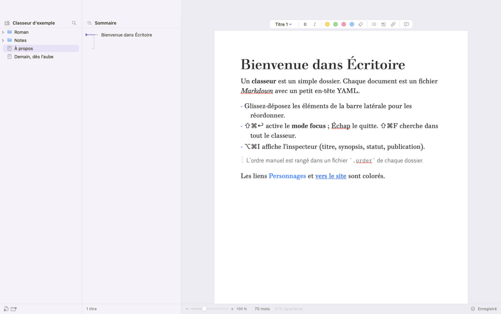
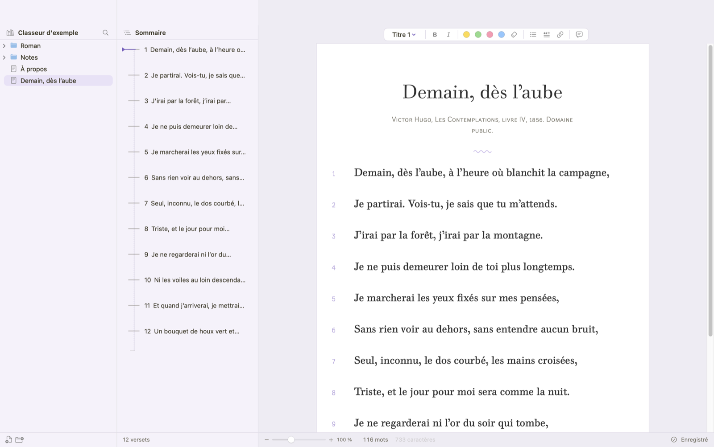
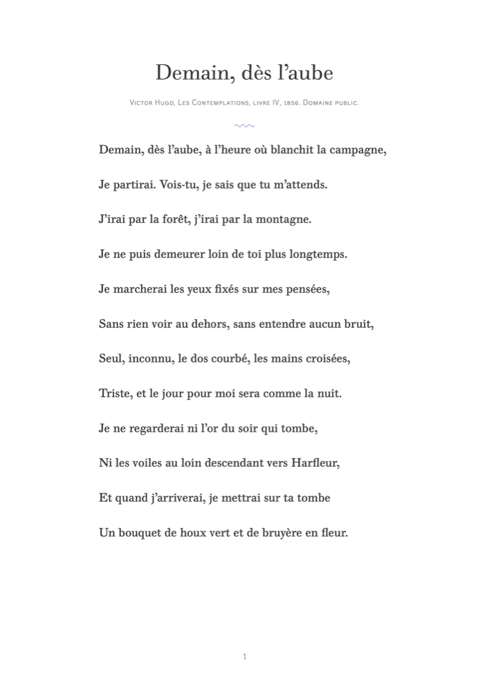

# Écritoire

*[English version](README.en.md)*

Écritoire est un traitement de texte pour macOS, pensé pour les textes longs. On y écrit dans un **classeur**,
c'est-à-dire un simple dossier de fichiers Markdown : vos textes restent lisibles par n'importe quel autre
logiciel, et vous pouvez les synchroniser, les versionner ou les relire avec les outils de votre choix.



## Ce que fait Écritoire

- **Un éditeur de texte, pas de code** : les signes Markdown (`**`, `#`, `>`) disparaissent et le texte est
  mis en forme comme sur une page. Ils réapparaissent, estompés, seulement dans le paragraphe du curseur.
- **Le classeur** : arborescence de dossiers et de documents, ordre manuel par glisser-déposer, icônes,
  sommaire du document, recherche dans tout le classeur (⇧⌘F), sans tenir compte des accents.
- **L'écriture** : mode focus, défilement « machine à écrire », zoom, inspecteur (titre, synopsis, statut).
- **La relecture** : commentaires ancrés dans le texte, instantanés et vue des modifications (accepter ou
  refuser chaque changement), surligneurs de couleur.
- **Les poèmes** : un vers par paragraphe, numéros de vers dans la marge, renumérotation automatique,
  références « v. 12 ».
- **L'export** : Markdown propre, ou PDF A4 fidèle à la page (Fichier → Exporter…, ⇧⌘E). Un dossier entier
  devient un seul fichier.
- **L'import Scrivener** : un projet `.scriv` devient un classeur, sans que l'original soit modifié.





## Construire l'application

Il faut macOS 14 ou plus récent et les outils de développement en ligne de commande d'Apple
(`xcode-select --install`). Xcode n'est pas nécessaire.

```sh
git clone <adresse du dépôt> Ecritoire
cd Ecritoire
./scripts/construire-app.sh              # fabrique Ecritoire.app dans ce dossier
open Ecritoire.app
./scripts/construire-app.sh --installer  # ou : copie l'app dans ~/Applications
```

Pour développer : `swift run Ecritoire --classeur "Classeur d'exemple"`.
Vérifications : `swift build && swift run EcritoireVerifs`.

Sans Xcode, deux contraintes : pas de `@State` SwiftUI, ni de tests XCTest ou Swift Testing (leurs macros
ne sont livrées qu'avec Xcode). Les vérifications sont donc un exécutable, `EcritoireVerifs`.

## Mises à jour

L'app vérifie une fois par jour s'il existe une nouvelle version (menu **Écritoire → Rechercher les mises à jour…**),
la télécharge et l'installe d'elle-même, grâce à [Sparkle](https://sparkle-project.org) (licence MIT). Les versions
sont publiées dans les [releases GitHub](https://github.com/brunmul/ecritoire/releases), signées en EdDSA.

L'app n'est pas signée par Apple : au premier lancement d'une version téléchargée, ouvrez-la par clic droit → Ouvrir
(sur macOS 15 et plus récent : Réglages Système → Confidentialité et sécurité → « Ouvrir quand même »).

Publier une version (mainteneur) : `./scripts/publier-version.sh 0.2`. La clé privée de signature reste dans le
trousseau du Mac du mainteneur, jamais dans le dépôt.

## Polices

Écritoire utilise **Walbaum** et **Walbaum Grotesk** si elles sont installées sur le Mac. Ce sont des polices
payantes : elles ne sont jamais distribuées avec le logiciel. Sinon, Écritoire utilise deux polices libres
fournies avec l'app, [Libre Bodoni](https://github.com/google/fonts/tree/main/ofl/librebodoni) et
[Hanken Grotesk](https://github.com/google/fonts/tree/main/ofl/hankengrotesk), sous licence SIL Open Font
License (fichiers et licences dans `Resources/Polices`).

## Importer un projet Scrivener

Dans l'app : **Fichier → Importer un projet Scrivener…** (⇧⌘I). En ligne de commande, pour plusieurs projets :

```sh
swift run -c release importer-scrivener MesProjets/*.scriv             # → ~/Documents/Classeurs
swift run -c release importer-scrivener projet.scriv --vers ~/autre/dossier
```

Le projet d'origine n'est jamais modifié. Sont conservés : l'arborescence et l'ordre, les titres, le gras,
l'italique, les listes, les liens, les citations et les titres de section (d'après les styles Scrivener), les
images (copiées à côté du document), le synopsis, le statut, l'étiquette, les mots-clés, les notes
(en commentaire `%% … %%`) et les dates. La corbeille n'est pas importée. Ne sont pas conservés : les notes de
bas de page et les commentaires Scrivener, les tableaux (texte brut), les instantanés, la mise en page.

## Format du classeur

- Un dossier du classeur est un dossier ; un document est un fichier `.md`. Les autres fichiers sont ignorés.
- Ordre manuel : un fichier `.order` dans chaque dossier, un nom par ligne.
- En-tête YAML de chaque document (clés compatibles avec Quartz) ; les autres clés sont conservées telles quelles :

  ```yaml
  ---
  title: "Le départ"
  synopsis: "Élise quitte la ville à l'aube."
  status: "brouillon"     # idée, brouillon, en cours, relu, terminé
  publish: false
  ---
  ```

- Ce qui n'est pas du texte (commentaires, instantanés, affichage poème ou prose) est rangé dans un dossier
  `.ecritoire` à la racine du classeur, jamais dans les fichiers Markdown.

Sauvegarde automatique 0,8 s après la dernière frappe, et en quittant. Si un document ouvert est modifié par
un autre programme, il est rechargé ; en cas de conflit, un bandeau vous laisse choisir.

## Raccourcis

| | |
|---|---|
| ⌘N / ⇧⌘N | Nouveau document / dossier |
| ⌘O | Ouvrir un classeur |
| ⇧⌘E | Exporter (Markdown ou PDF) |
| ⇧⌘F | Rechercher dans le classeur ou dans tous les classeurs |
| ⇧⌘↩ | Mode focus (Échap pour sortir) |
| ⌥⌘T | Défilement machine à écrire |
| ⌥⌘I | Inspecteur |
| ⌥⌘M / ⌥⌘C | Commenter la sélection / afficher les commentaires |
| ⌥⌘R | Voir les modifications depuis l'instantané |
| ⌥⌘0 à ⌥⌘6 | Styles de paragraphe |
| ⌘+ / ⌘− / ⌘0 | Taille du texte |

## Structure du code

- `Sources/EcritoireCore` : la logique sans interface (en-tête YAML, classeur et `.order`, commentaires,
  poèmes, recherche, export Markdown, surveillance du disque).
- `Sources/Ecritoire` : l'application (SwiftUI et AppKit, éditeur NSTextView TextKit 2, export PDF).
- `Sources/ScrivenerImport` et `Sources/ImporterScrivener` : l'import Scrivener.
- `Sources/EcritoireVerifs` : les vérifications.
- Aucune dépendance externe.

## Licence

Écritoire est un logiciel libre, distribué sous la licence publique générale GNU, version 3 ou (à votre choix)
toute version ultérieure : voir [LICENSE](LICENSE). Les polices de `Resources/Polices` gardent leur propre
licence (SIL Open Font License).
